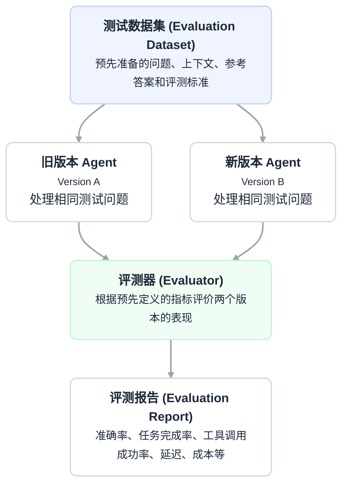

# 单轮评测（Single-Turn Evals）

## 概述（第一节课-Understanding Evals）

本节课程将聚焦于 AI 智能体的**评测方法**，重点讲解**单轮工具选择评测（Single-Turn Tool Selection Evals）**，以及如何通过**链路追踪（tracing）**实现系统的**可观测性（observability）**。

我们将使用 **Laminar** 来运行评测，并借助 **OpenTelemetry（OTEL）** 来追踪智能体的运行行为。

---

## 为什么需要评测？

评测（Evaluations，简称 Evals）在 AI 智能体开发中至关重要，原因如下：

* **智能体具有非确定性（non-deterministic）**：相同的输入可能**会产生不同的输出**，这使得传统的确定性测试手段不再够用。
* **质量回退（Quality regression）**：模型升级、提示词（prompt）调整或工具修改，都可能在不知不觉中导致性能下降。
* **为上线提供信心**：在发布变更之前，你需要可量化的指标作为依据。
* **问题排查（Debugging）**：当出现异常时，你需要弄清楚智能体当初为什么会做出某个决策。

没有评测，开发就如同“盲飞”（两眼一抹黑）。仅凭几次手动测试，你可能会以为智能体表现很好，但**一旦进入生产环境，它就可能以你完全意想不到的方式频频出错**。

---

## 离线评测 vs. 在线评测

### 离线评测（Offline Evals）

* 在部署上线前，针对固定的数据集（dataset）运行测试
* 专门验证你精心筛选出来的特定场景
* 在开发阶段提供快速反馈闭环
* 非常适合做**回归测试（regression testing）**，确保新改动不会破坏既有行为
* **这就是我们今天要搭建的评测体系**

> **回归评测（Regression Evaluation）**：修改系统后，重新运行已有测试集，检查原本正确的能力有没有被破坏。它通常是离线评测的一种重要用途。

#### 什么是离线评测及其工作方式

**离线评测（Offline Evaluation）** 是指：在不让 AI 模型实时参与用户请求、不影响线上用户体验的情况下，使用一批预先准备好的测试数据，对 AI 系统的表现进行系统性测试和评价。

> 简单来说：**离线评测（Offline Evaluation）**用固定测试集检验系统，主要用于开发阶段的质量验证。

它主要回答一个问题：如果我们修改了 Prompt、模型、Agent 工作流或者工具调用逻辑，新版本是否真的比旧版本更好？

它是 AI 应用和 Agent 工程中非常重要的一种质量保障手段。

离线评测是怎么工作的？核心思路是：提前准备测试数据集，让不同版本的 AI 系统处理相同的问题，然后比较结果。



例如，准备以下测试数据：

| 测试问题                         | 预期行为             |
| -------------------------------- | -------------------- |
| TypeScript 7 有哪些变化？        | 搜索官方资料并总结   |
| React Server Components 是什么？ | 优先查询权威技术资料 |
| 某个问题没有可靠资料怎么办？     | 明确说明信息不足     |
| 两个技术方案有什么区别？         | 搜集双方资料并比较   |

让两个版本分别运行这些测试用例，再进行比较。

#### 离线评测具体评测什么？

对于 Agent，不能只关注最终答案是否正确，还需要评价中间执行过程。常见指标包括：

| 评测维度             | 具体含义             |
| -------------------- | -------------------- |
| Answer Quality       | 最终答案的质量       |
| Accuracy             | 答案是否准确         |
| Relevance            | 答案是否与问题相关   |
| Tool Selection       | 是否选择了正确的工具 |
| Tool Success Rate    | 工具调用成功率       |
| Task Completion Rate | 任务完成率           |
| Latency              | 完成任务所需时间     |
| Cost                 | 完成任务消耗的费用   |

假设你的 Agent 原本需要搜索 10 次才能完成任务，修改后只需要搜索 4 次。但是，搜索次数减少不一定意味着 Agent 变好了。如果新版本因此遗漏了重要资料，最终答案质量反而下降了。所以，离线评测需要综合考虑多个指标，而不是只优化一个数字。

----

### 在线评测（Online Evals）

* 在生产环境中直接针对真实用户流量运行
* 捕捉测试用例未能覆盖到的意外问题
* 通过**采样（sampling）**机制抽取一定比例的请求进行评估
* 通常采用 **LLM-as-judge（大模型充当裁判）** 的方式进行质量打分
* 成本更高，但能有效发现真实场景下的**边界情况（edge cases）**

---

#### 什么在线评测以及为什么需要它

**在线评测（Online Evaluation）** 是指：在 AI 系统实际运行的线上环境中，利用真实用户请求、用户行为和反馈，持续评估 AI 系统的实际表现。

> 简单来说：**在线评测（Online Evaluation）**在真实用户环境中检验系统，观察实际使用效果。

它主要回答一个问题：**AI 系统在真实用户使用过程中，表现究竟怎么样？它是否真正满足了用户需求？**

与离线评测相比，在线评测关注的不只是测试数据上的表现，而是 AI 系统在真实环境中的实际效果。

为什么需要在线评测？

假设你开发了一个 DeepSearch Agent。在开发阶段，你**通过离线评测发现**：

| 指标             | Agent V1 | Agent V2 |
| ---------------- | -------- | -------- |
| 答案准确率       | 82%      | 91%      |
| 任务完成率       | 80%      | 90%      |
| 平均工具调用次数 | 8        | 5        |

从测试结果看，V2 明显更好。但是，当 V2 真正部署到线上后，可能出现一些问题：

- 真实用户的问题比测试集复杂得多。
- 用户经常提出模糊的问题。
- 某些工具在真实网络环境中不稳定。
- 用户不满意答案，却没有直接报告错误。
- Agent 的响应时间太长，用户中途退出。

这说明了：这些问题很难完全通过离线评测发现。因此，我们还需要在线评测。

---

## 评测数据从哪里来？

* **合成数据（Synthetic data）**：根据预期使用场景手动编写测试样例（即本节课采用的方式）。
* **生产环境日志（Production logs）**：从真实用户交互中采样（最适合用于在线评测）。
* **边界案例挖掘（Edge case mining）**：从生产环境的失败案例中收集样本，补充进测试集。
* **红队测试（Red teaming）**：刻意尝试诱导或攻破智能体，并将这些异常用例记录下来。
* **LLM 生成数据**：利用另一个 LLM 来批量生成测试用例（需注意数据偏差问题）。

最理想的评测数据集应当融合以上所有来源。建议**从合成数据起步**，随后持续将生产环境中的真实失败案例纳入其中。

---

## 借助评测实现“爬山式”迭代（Hill Climbing）

评测能够支撑**爬山式渐进优化（hill climbing）**，让你持续迭代提升智能体表现：

1. 运行评测，获取**基线分数（baseline scores）**
2. 做出一项改动（调整提示词、更换模型、修改工具等）
3. 再次运行评测
4. 如果分数提升，则保留该改动；如果下降，则回滚还原
5. 不断重复上述过程

这就是系统化改进智能体的正确路径——**不再靠“感觉（vibe）”瞎猜，每一次改动都有数据支撑**。

---

## 核心概念

### 单轮评测（Single-Turn Evals）

**单轮评测**测试的是单次交互过程——即一条用户消息以及智能体紧接着做出的直接响应。它非常适合用来检验以下能力：

* **工具选择（Tool selection）**：智能体是否选对了工具？
* **参数提取（Parameter extraction）**：智能体是否提取出了正确的调用参数？
* **拒用行为（Refusal behavior）**：在不该使用工具的场景下，智能体是否能克制住不去调用工具？

单轮评测速度快、成本低，并且能提供高信噪比（high signal）的明确信号，帮你快速判断智能体是否真正理解“何时该用哪个工具”。

---

### 评测用例分类

我们将测试用例划分为以下三类：

* **黄金用例（Golden）**：必须精准选中预期的全部工具，没有任何模糊空间。
* **次级用例（Secondary）**：大概率会选用某些工具，但允许一定的灵活性，通常基于精确率（precision）**和**召回率（recall）进行评分。
* **负向用例（Negative）**：**绝对不能**选中被禁止的工具，用于测试智能体是否会出现“越界调用”。

---

### 评分器（Scorers / Evaluators）

评分器（Scorers，也称 Evaluators）是接收智能体实际输出与预期目标（target）并返回一个分值（通常在 0 到 1 之间）的函数：

* **`toolsSelectedBinary`**：是否选中了**所有**预期工具？（二值评分）
* **`toolsAvoidedBinary`**：是否避开了**所有**禁用工具？（二值评分）
* **`toolSelectionScore`**：计算 **F1 分数（F1 score，综合平衡精确率与召回率）**，用于对部分命中的情况给予部分得分。

---

## 使用 Laminar 实现链路追踪与可观测性（第二节课- Evals Telemetry with Laminar）

### 为什么链路追踪（Tracing）如此重要？

当智能体做出某个决策时，你需要看清背后的完整细节：

* 它当时掌握了哪些上下文（context）？
* 它评估过哪些可用工具？
* 为什么最终选择了那个工具？
* 每个步骤分别耗时多久？

**OTEL（OpenTelemetry）链路追踪**通过层级化的 **Span（跨度）** 完整呈现整个执行流，为你提供这种透明的可观测能力。

### 配置 Laminar

1. 前往 `laminar.ai` 注册一个免费账号（2026/11/18是https://laminar.sh/）
2. 创建一个新项目
3. 复制你的 API key（去project里面的settings获取）
4. 将其添加到 `.env` 文件中：`LMNR_API_KEY=your_api_key_here`

Laminar 提供以下核心功能：

* 追踪链路（Trace）可视化
* 评测执行与结果追踪
* 随时间维度的分数聚合分析
* 数据集管理

> 集成的话看这里：https://laminar.sh/docs/integrations/vercel-ai-sdk

---

## 代码

### src/agent/run.ts

在智能体中添加 Laminar 初始化与 OTEL 链路追踪：

```typescript
import { streamText, type ModelMessage } from "ai";
import { openai } from "@ai-sdk/openai";
import { getTracer } from "@lmnr-ai/lmnr";
import { tools } from "./tools/index.ts";
import { executeTool } from "./executeTool.ts";
import { SYSTEM_PROMPT } from "./system/prompt.ts";
import { Laminar } from "@lmnr-ai/lmnr";
import type { AgentCallbacks, ToolCallInfo } from "../types.ts";
import { filterCompatibleMessages } from "./system/filterMessages.ts";

Laminar.initialize({
  projectApiKey: process.env.LMNR_API_KEY,
});

const MODEL_NAME = "gpt-5-mini";

export async function runAgent(
  userMessage: string,
  conversationHistory: ModelMessage[],
  callbacks: AgentCallbacks,
): Promise<ModelMessage[]> {
  // Filter and check if we need to compact the conversation history before starting
  const workingHistory = filterCompatibleMessages(conversationHistory);

  const messages: ModelMessage[] = [
    { role: "system", content: SYSTEM_PROMPT },
    ...workingHistory,
    { role: "user", content: userMessage },
  ];

  let fullResponse = "";

  while (true) {
    const result = streamText({
      model: openai(MODEL_NAME),
      messages,
      tools,
      experimental_telemetry: {
        isEnabled: true,
        tracer: getTracer(),
      },
    });

    const toolCalls: ToolCallInfo[] = [];
    let currentText = "";
    let streamError: Error | null = null;

    try {
      for await (const chunk of result.fullStream) {
        if (chunk.type === "text-delta") {
          currentText += chunk.text;
          callbacks.onToken(chunk.text);
        }

        if (chunk.type === "tool-call") {
          const input = "input" in chunk ? chunk.input : {};
          toolCalls.push({
            toolCallId: chunk.toolCallId,
            toolName: chunk.toolName,
            args: input as Record<string, unknown>,
          });
          callbacks.onToolCallStart(chunk.toolName, input);
        }
      }
    } catch (error) {
      streamError = error as Error;
      // If we have some text, continue processing
      // Otherwise, rethrow if it's not a "no output" error
      if (
        !currentText &&
        !streamError.message.includes("No output generated")
      ) {
        throw streamError;
      }
    }

    fullResponse += currentText;

    // If stream errored with "no output" and we have no text, try to recover
    if (streamError && !currentText) {
      // Add a fallback response
      fullResponse =
        "I apologize, but I wasn't able to generate a response. Could you please try rephrasing your message?";
      callbacks.onToken(fullResponse);
      break;
    }

    const finishReason = await result.finishReason;

    if (finishReason !== "tool-calls" || toolCalls.length === 0) {
      const responseMessages = await result.response;
      messages.push(...responseMessages.messages);

      break;
    }

    const responseMessages = await result.response;
    messages.push(...responseMessages.messages);

    for (const tc of toolCalls) {
      const result = await executeTool(tc.toolName, tc.args);
      callbacks.onToolCallEnd(tc.toolName, result);

      messages.push({
        role: "tool",
        content: [
          {
            type: "tool-result",
            toolCallId: tc.toolCallId,
            toolName: tc.toolName,
            output: { type: "text", value: result },
          },
        ],
      });
    }
  }

  callbacks.onComplete(fullResponse);

  return messages;
}
```

---

### evals/evaluators.ts

添加用于评估工具选择表现的评分器函数：

```typescript
export function toolsSelected(
  output: SingleTurnResult | MultiTurnResult,
  target: EvalTarget | MultiTurnTarget,
): number {
  const expectedTools =
    "expectedTools" in target
      ? target.expectedTools
      : "expectedToolOrder" in target
        ? target.expectedToolOrder
        : undefined;

  if (!expectedTools?.length) return 1;

  const selected = new Set(
    "toolNames" in output ? output.toolNames : output.toolsUsed,
  );

  return expectedTools.every((t) => selected.has(t)) ? 1 : 0;
}

/**
 * Evaluator: Check if forbidden tools were avoided.
 * Returns 1 if NONE of the forbidden tools are in the output, 0 otherwise.
 * For negative prompts.
 */
export function toolsAvoided(
  output: SingleTurnResult | MultiTurnResult,
  target: EvalTarget | MultiTurnTarget,
): number {
  if (!target.forbiddenTools?.length) return 1;

  const selected = new Set(
    "toolNames" in output ? output.toolNames : output.toolsUsed,
  );

  return target.forbiddenTools.some((t) => selected.has(t)) ? 0 : 1;
}

/**
 * Evaluator: Check if tools were called in the expected order.
 * Returns the fraction of expected tools found in sequence.
 * Order matters but tools don't need to be consecutive.
 */
export function toolOrderCorrect(
  output: MultiTurnResult,
  target: MultiTurnTarget,
): number {
  if (!target.expectedToolOrder?.length) return 1;

  const actualOrder = output.toolCallOrder;

  // Check if expected tools appear in order (not necessarily consecutive)
  let expectedIdx = 0;
  for (const toolName of actualOrder) {
    if (toolName === target.expectedToolOrder[expectedIdx]) {
      expectedIdx++;
      if (expectedIdx === target.expectedToolOrder.length) break;
    }
  }

  return expectedIdx / target.expectedToolOrder.length;
}
```

---

### evals/executors.ts

添加使用模拟工具（mocked tools）的单轮执行器（executor）：

```typescript
import { generateText, stepCountIs, tool, type ToolSet } from "ai";
import { openai } from "@ai-sdk/openai";
import { z } from "zod";
import type {
  EvalData,
  SingleTurnResult,
  MultiTurnEvalData,
  MultiTurnResult,
} from "./types.ts";
import { buildMessages, buildMockedTools } from "./utils.ts";

/**
 * Tool definitions for mocked single-turn evaluations.
 * These define the schema the LLM sees without real implementations.
 */
const TOOL_DEFINITIONS: Record<
  string,
  { description: string; parameters: z.ZodObject<z.ZodRawShape> }
> = {
  // File tools
  readFile: {
    description: "Read the contents of a file at the specified path",
    parameters: z.object({
      path: z.string().describe("The path to the file to read"),
    }),
  },
  writeFile: {
    description: "Write content to a file at the specified path",
    parameters: z.object({
      path: z.string().describe("The path to the file to write"),
      content: z.string().describe("The content to write to the file"),
    }),
  },
  listFiles: {
    description: "List all files in a directory",
    parameters: z.object({
      path: z.string().describe("The directory path to list files from"),
    }),
  },
  deleteFile: {
    description: "Delete a file at the specified path",
    parameters: z.object({
      path: z.string().describe("The path to the file to delete"),
    }),
  },
  // Shell tools
  runCommand: {
    description: "Execute a shell command and return its output",
    parameters: z.object({
      command: z.string().describe("The shell command to execute"),
    }),
  },
};

/**
 * Single-turn executor with mocked tools.
 * Uses predefined tool definitions - tools never execute, only selection is tested.
 */
export async function singleTurnWithMocks(
  data: EvalData,
): Promise<SingleTurnResult> {
  const messages = buildMessages(data);

  // Build mocked tools from definitions
  const tools: ToolSet = {};
  for (const toolName of data.tools) {
    const def = TOOL_DEFINITIONS[toolName];
    if (def) {
      tools[toolName] = tool({
        description: def.description,
        inputSchema: def.parameters,
      });
    }
  }

  const result = await generateText({
    model: openai(data.config?.model ?? "gpt-4o-mini"),
    messages,
    tools,
    stopWhen: stepCountIs(1),
    temperature: data.config?.temperature ?? undefined,
  });

  // Extract tool calls from the result
  const toolCalls = (result.toolCalls ?? []).map((tc) => ({
    toolName: tc.toolName,
    args: "args" in tc ? tc.args : {},
  }));

  const toolNames = toolCalls.map((tc) => tc.toolName);

  return {
    toolCalls,
    toolNames,
    selectedAny: toolNames.length > 0,
  };
}

/**
 * Multi-turn executor with mocked tools.
 * Runs a complete agent loop with tools returning fixed values.
 */
```

---

### evals/file-tools.eval.ts

创建用于文件工具选择的评测脚本：

```typescript
import { evaluate } from "@lmnr-ai/lmnr";
import {
  toolsSelected,
  toolsAvoided,
  toolSelectionScore,
} from "./evaluators.ts";
import type { EvalData, EvalTarget } from "./types.ts";
import dataset from "./data/file-tools.json" with { type: "json" };
import { singleTurnWithMocks } from "./executors.ts";

/**
 * File Tools Selection Evaluation
 *
 * Tests whether the LLM correctly selects file-related tools
 * (readFile, writeFile, listFiles, deleteFile) based on user prompts.
 *
 * Categories:
 * golden: Must select specific expected tools
 * secondary: Likely selects certain tools, scored on precision/recall
 * negative: Must NOT select any file tools
 */

// Executor that runs single-turn tool selection with mocked tools
const executor = async (data: EvalData) => {
  return singleTurnWithMocks(data);
};

// Run the evaluation
evaluate({
  data: dataset as Array<{ data: EvalData; target: EvalTarget }>,
  executor,
  evaluators: {
    // For golden prompts: did it select all expected tools?
    toolsSelected: (output, target) => {
      if (target?.category !== "golden") return 1; // Skip for non-golden
      return toolsSelected(output, target);
    },
    // For negative prompts: did it avoid forbidden tools?
    toolsAvoided: (output, target) => {
      if (target?.category !== "negative") return 1; // Skip for non-negative
      return toolsAvoided(output, target);
    },
    // For secondary prompts: precision/recall score
    selectionScore: (output, target) => {
      if (target?.category !== "secondary") return 1; // Skip for non-secondary
      return toolSelectionScore(output, target);
    },
  },
  config: {
    projectApiKey: process.env.LMNR_API_KEY,
  },
  groupName: "file-tools-selection",
});
```

---

### evals/shell-tools.eval.ts

创建用于 Shell 工具选择的评测脚本：

```typescript
import { evaluate } from "@lmnr-ai/lmnr";
import {
  toolsSelected,
  toolsAvoided,
  toolSelectionScore,
} from "./evaluators.ts";
import type { EvalData, EvalTarget } from "./types.ts";
import dataset from "./data/shell-tools.json" with { type: "json" };
import { singleTurnWithMocks } from "./executors.ts";

/**
 * Shell Tools Selection Evaluation
 *
 * Tests whether the LLM correctly selects the shell command tool
 * (runCommand) based on user prompts.
 *
 * Categories:
 * golden: Must select runCommand for explicit shell requests
 * secondary: Likely selects runCommand, scored on precision/recall
 * negative: Must NOT use shell for non-shell tasks
 */

// Executor that runs single-turn tool selection with mocked tools
const executor = async (data: EvalData) => {
  return singleTurnWithMocks(data);
};

// Run the evaluation
evaluate({
  data: dataset as Array<{ data: EvalData; target: EvalTarget }>,
  executor,
  evaluators: {
    // For golden prompts: did it select runCommand?
    toolsSelected: (output, target) => {
      if (target?.category !== "golden") return 1;
      return toolsSelected(output, target);
    },
    // For negative prompts: did it avoid runCommand?
    toolsAvoided: (output, target) => {
      if (target?.category !== "negative") return 1;
      return toolsAvoided(output, target);
    },
    // For secondary prompts: precision/recall score
    selectionScore: (output, target) => {
      if (target?.category !== "secondary") return 1;
      return toolSelectionScore(output, target);
    },
  },
  config: {
    projectApiKey: process.env.LMNR_API_KEY,
  },
  groupName: "shell-tools-selection",
});
```

---

### evals/data/file-tools.json

文件工具评测的示例数据集：

```json
[
  {
    "data": {
      "prompt": "Read the contents of package.json",
      "tools": ["readFile", "writeFile", "listFiles", "deleteFile"]
    },
    "target": {
      "expectedTools": ["readFile"],
      "category": "golden"
    },
    "metadata": {
      "description": "Direct file read request - should use readFile"
    }
  },
  {
    "data": {
      "prompt": "Show me all the files in the src directory",
      "tools": ["readFile", "writeFile", "listFiles", "deleteFile"]
    },
    "target": {
      "expectedTools": ["listFiles"],
      "category": "golden"
    },
    "metadata": {
      "description": "Directory listing request - should use listFiles"
    }
  },
  {
    "data": {
      "prompt": "Create a new file called hello.txt with the content 'Hello World'",
      "tools": ["readFile", "writeFile", "listFiles", "deleteFile"]
    },
    "target": {
      "expectedTools": ["writeFile"],
      "category": "golden"
    },
    "metadata": {
      "description": "File creation request - should use writeFile"
    }
  },
  {
    "data": {
      "prompt": "What's in this project? Show me around.",
      "tools": ["readFile", "writeFile", "listFiles", "deleteFile"]
    },
    "target": {
      "expectedTools": ["listFiles"],
      "category": "secondary"
    },
    "metadata": {
      "description": "Ambiguous exploration request - likely uses listFiles"
    }
  },
  {
    "data": {
      "prompt": "What is the capital of France?",
      "tools": ["readFile", "writeFile", "listFiles", "deleteFile"]
    },
    "target": {
      "forbiddenTools": ["readFile", "writeFile", "listFiles", "deleteFile"],
      "category": "negative"
    },
    "metadata": {
      "description": "General knowledge question - should NOT use any file tools"
    }
  }
]
```

---

### evals/data/shell-tools.json

Shell 工具评测的示例数据集：

```json
[
  {
    "data": {
      "prompt": "Run npm install to install the dependencies",
      "tools": ["runCommand"]
    },
    "target": {
      "expectedTools": ["runCommand"],
      "category": "golden"
    },
    "metadata": {
      "description": "Package installation request - should use runCommand"
    }
  },
  {
    "data": {
      "prompt": "Check the git status of this repository",
      "tools": ["runCommand"]
    },
    "target": {
      "expectedTools": ["runCommand"],
      "category": "golden"
    },
    "metadata": {
      "description": "Git status request - should use runCommand"
    }
  },
  {
    "data": {
      "prompt": "What is TypeScript used for?",
      "tools": ["runCommand"]
    },
    "target": {
      "forbiddenTools": ["runCommand"],
      "category": "negative"
    },
    "metadata": {
      "description": "General knowledge question - should NOT use shell"
    }
  }
]
```

---

## 运行评测

```bash
# Run file tools eval
npx tsx evals/file-tools.eval.ts

# Run shell tools eval
npx tsx evals/shell-tools.eval.ts
```

运行结果将显示在你的 Laminar 控制台（dashboard）中，你可以查看每个评分器的具体得分以及汇总统计指标。

---

### 译注与代码说明

1. **原文代码可能存在的问题（译文中均已原样保留，未作修改）**：
   * **缺失 `toolSelectionScore` 函数导出**：在 `evals/file-tools.eval.ts` 和 `evals/shell-tools.eval.ts` 中均从 `./evaluators.ts` 导入了 `toolSelectionScore`，正文“评分器”一节也介绍了它的作用（计算 F1 分数），但 `evals/evaluators.ts` 代码片段中只贴出了 `toolsSelected`、`toolsAvoided` 和 `toolOrderCorrect`，遗漏了 `toolSelectionScore` 的定义，直接运行会触发模块导出缺失报错。
   * **代码注释粘连与残缺片段**：
     * 多个文件顶部的 `import` 语句在原文排版中丢失了换行（如 `import ...;import ...;`），以及注释结束符 `*/` 与随后的 `export`、`const` 粘连在同一行（虽然在 JS/TS 语法上仍可解析，但可读性较差）。
     * `evals/executors.ts` 末尾多出了一段 `Multi-turn executor with mocked tools.` 的注释，但下方没有对应函数体（应为原作者截取下一课多轮评测代码时的残留注释）。
   * **未展示的辅助模块引用**：`src/agent/run.ts` 引入了 `./system/filterMessages.ts` 中的 `filterCompatibleMessages`，`evals/executors.ts` 引入了 `./utils.ts` 和 `./types.ts`，这些文件在当前课程贴出的代码片段中暂未给出。
   * **变量遮蔽（Variable Shadowing）**：`src/agent/run.ts` 的 `for (const tc of toolCalls)` 循环内部声明了 `const result = await executeTool(...)`，遮蔽了外层 `while` 循环中的 `const result = streamText(...)`（作用域合法，但阅读时需注意区分）。

2. **术语说明**：
   * **Evals**：AI 工程领域普遍直接称“Evals”或译为“评测”，文中首次出现标注全称，后续统一译为“评测”。
   * **Scorers / Evaluators**：原文标题将两者并列，代码配置项中用的是 `evaluators`，正文统一译为“评分器”。