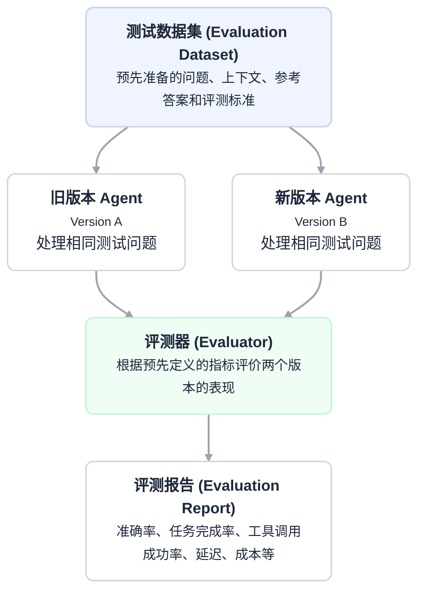
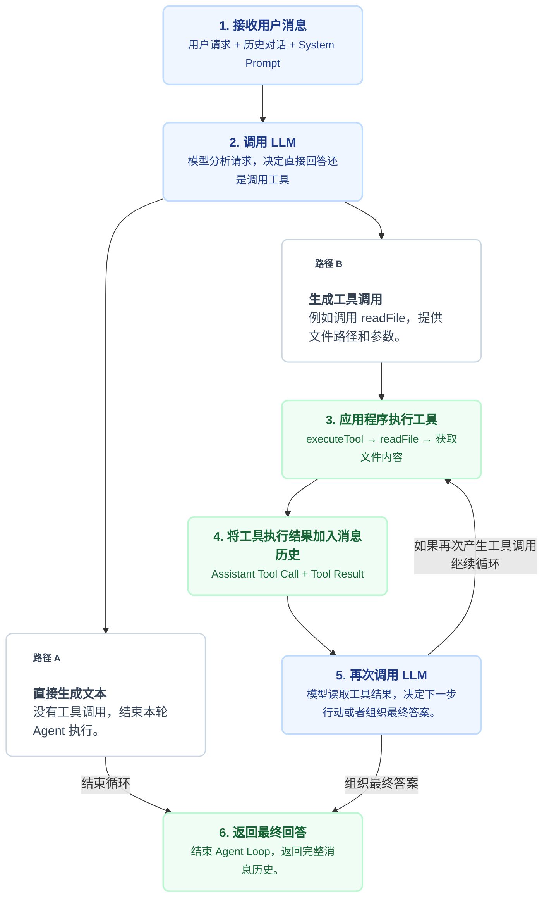
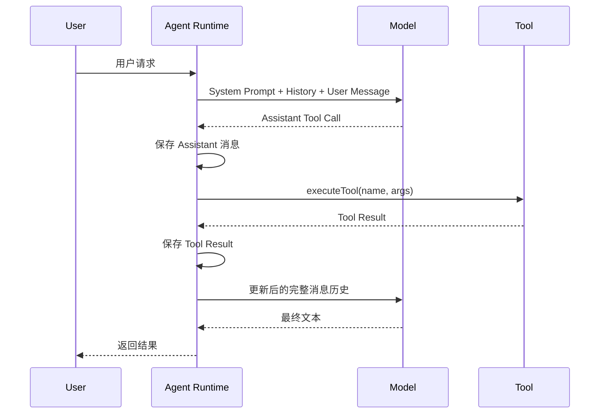
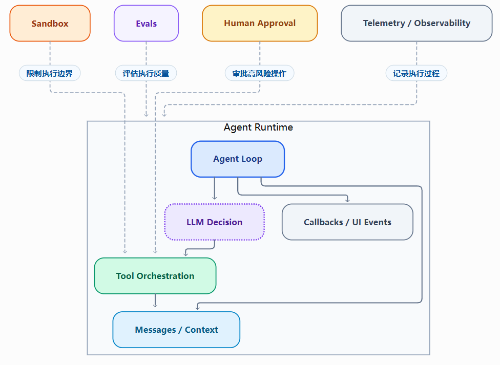

# 单轮评测（Single-Turn Evals）

## 概述（第一节课-Understanding Evals）

本节课程将聚焦于 AI 智能体的**评测方法**，重点讲解**单轮工具选择评测（Single-Turn Tool Selection Evals）**，以及如何通过**链路追踪（tracing）**实现系统的**可观测性（observability）**。

我们将使用 **Laminar** 来运行评测，并借助 **OpenTelemetry（OTEL）** 来追踪智能体的运行行为。

---

## 为什么需要评测？

评测（Evaluations，简称 Evals）在 AI 智能体开发中至关重要，原因如下：

* **智能体具有非确定性（non-deterministic）**：相同的输入可能**会产生不同的输出**，这使得传统的确定性测试手段不再够用。
* **质量回退（Quality regression）**：模型升级、提示词（prompt）调整或工具修改，都可能在不知不觉中导致性能下降。
* **为上线提供信心**：在发布变更之前，你需要可量化的指标作为依据。
* **问题排查（Debugging）**：当出现异常时，你需要弄清楚智能体当初为什么会做出某个决策。

没有评测，开发就如同“盲飞”（两眼一抹黑）。仅凭几次手动测试，你可能会以为智能体表现很好，但**一旦进入生产环境，它就可能以你完全意想不到的方式频频出错**。

---

## 离线评测 vs. 在线评测

### 离线评测（Offline Evals）

* 在部署上线前，针对固定的数据集（dataset）运行测试
* 专门验证你精心筛选出来的特定场景
* 在开发阶段提供快速反馈闭环
* 非常适合做**回归测试（regression testing）**，确保新改动不会破坏既有行为
* **这就是我们今天要搭建的评测体系**

> **回归评测（Regression Evaluation）**：修改系统后，重新运行已有测试集，检查原本正确的能力有没有被破坏。它通常是离线评测的一种重要用途。

#### 什么是离线评测及其工作方式

**离线评测（Offline Evaluation）** 是指：在不让 AI 模型实时参与用户请求、不影响线上用户体验的情况下，使用一批预先准备好的测试数据，对 AI 系统的表现进行系统性测试和评价。

> 简单来说：**离线评测（Offline Evaluation）**用固定测试集检验系统，主要用于开发阶段的质量验证。

它主要回答一个问题：如果我们修改了 Prompt、模型、Agent 工作流或者工具调用逻辑，新版本是否真的比旧版本更好？

它是 AI 应用和 Agent 工程中非常重要的一种质量保障手段。

离线评测是怎么工作的？核心思路是：提前准备测试数据集，让不同版本的 AI 系统处理相同的问题，然后比较结果。



例如，准备以下测试数据：

| 测试问题                         | 预期行为             |
| -------------------------------- | -------------------- |
| TypeScript 7 有哪些变化？        | 搜索官方资料并总结   |
| React Server Components 是什么？ | 优先查询权威技术资料 |
| 某个问题没有可靠资料怎么办？     | 明确说明信息不足     |
| 两个技术方案有什么区别？         | 搜集双方资料并比较   |

让两个版本分别运行这些测试用例，再进行比较。

#### 离线评测具体评测什么？

对于 Agent，不能只关注最终答案是否正确，还需要评价中间执行过程。常见指标包括：

| 评测维度             | 具体含义             |
| -------------------- | -------------------- |
| Answer Quality       | 最终答案的质量       |
| Accuracy             | 答案是否准确         |
| Relevance            | 答案是否与问题相关   |
| Tool Selection       | 是否选择了正确的工具 |
| Tool Success Rate    | 工具调用成功率       |
| Task Completion Rate | 任务完成率           |
| Latency              | 完成任务所需时间     |
| Cost                 | 完成任务消耗的费用   |

假设你的 Agent 原本需要搜索 10 次才能完成任务，修改后只需要搜索 4 次。但是，搜索次数减少不一定意味着 Agent 变好了。如果新版本因此遗漏了重要资料，最终答案质量反而下降了。所以，离线评测需要综合考虑多个指标，而不是只优化一个数字。

----

### 在线评测（Online Evals）

* 在生产环境中直接针对真实用户流量运行
* 捕捉测试用例未能覆盖到的意外问题
* 通过**采样（sampling）**机制抽取一定比例的请求进行评估
* 通常采用 **LLM-as-judge（大模型充当裁判）** 的方式进行质量打分
* 成本更高，但能有效发现真实场景下的**边界情况（edge cases）**

---

#### 什么在线评测以及为什么需要它

**在线评测（Online Evaluation）** 是指：在 AI 系统实际运行的线上环境中，利用真实用户请求、用户行为和反馈，持续评估 AI 系统的实际表现。

> 简单来说：**在线评测（Online Evaluation）**在真实用户环境中检验系统，观察实际使用效果。

它主要回答一个问题：**AI 系统在真实用户使用过程中，表现究竟怎么样？它是否真正满足了用户需求？**

与离线评测相比，在线评测关注的不只是测试数据上的表现，而是 AI 系统在真实环境中的实际效果。

为什么需要在线评测？

假设你开发了一个 DeepSearch Agent。在开发阶段，你**通过离线评测发现**：

| 指标             | Agent V1 | Agent V2 |
| ---------------- | -------- | -------- |
| 答案准确率       | 82%      | 91%      |
| 任务完成率       | 80%      | 90%      |
| 平均工具调用次数 | 8        | 5        |

从测试结果看，V2 明显更好。但是，当 V2 真正部署到线上后，可能出现一些问题：

- 真实用户的问题比测试集复杂得多。
- 用户经常提出模糊的问题。
- 某些工具在真实网络环境中不稳定。
- 用户不满意答案，却没有直接报告错误。
- Agent 的响应时间太长，用户中途退出。

这说明了：这些问题很难完全通过离线评测发现。因此，我们还需要在线评测。

---

## 评测数据从哪里来？

* **合成数据（Synthetic data）**：根据预期使用场景手动编写测试样例（即本节课采用的方式）。
* **生产环境日志（Production logs）**：从真实用户交互中采样（最适合用于在线评测）。
* **边界案例挖掘（Edge case mining）**：从生产环境的失败案例中收集样本，补充进测试集。
* **红队测试（Red teaming）**：刻意尝试诱导或攻破智能体，并将这些异常用例记录下来。
* **LLM 生成数据**：利用另一个 LLM 来批量生成测试用例（需注意数据偏差问题）。

最理想的评测数据集应当融合以上所有来源。建议**从合成数据起步**，随后持续将生产环境中的真实失败案例纳入其中。

---

## 借助评测实现“爬山式”迭代（Hill Climbing）

评测能够支撑**爬山式渐进优化（hill climbing）**，让你持续迭代提升智能体表现：

1. 运行评测，获取**基线分数（baseline scores）**
2. 做出一项改动（调整提示词、更换模型、修改工具等）
3. 再次运行评测
4. 如果分数提升，则保留该改动；如果下降，则回滚还原
5. 不断重复上述过程

这就是系统化改进智能体的正确路径——**不再靠“感觉（vibe）”瞎猜，每一次改动都有数据支撑**。

---

## 核心概念

### 单轮评测（Single-Turn Evals）

**单轮评测**测试的是单次交互过程——即一条用户消息以及智能体紧接着做出的直接响应。它非常适合用来检验以下能力：

* **工具选择（Tool selection）**：智能体是否选对了工具？
* **参数提取（Parameter extraction）**：智能体是否提取出了正确的调用参数？
* **拒用行为（Refusal behavior）**：在不该使用工具的场景下，智能体是否能克制住不去调用工具？

单轮评测速度快、成本低，并且能提供高信噪比（high signal）的明确信号，帮你快速判断智能体是否真正理解“何时该用哪个工具”。

---

### 评测用例分类

我们将测试用例划分为以下三类：

* **黄金用例（Golden）**：必须精准选中预期的全部工具，没有任何模糊空间。
* **次级用例（Secondary）**：大概率会选用某些工具，但允许一定的灵活性，通常基于精确率（precision）**和**召回率（recall）进行评分。
* **负向用例（Negative）**：**绝对不能**选中被禁止的工具，用于测试智能体是否会出现“越界调用”。

---

### 评分器（Scorers / Evaluators）

评分器（Scorers，也称 Evaluators）是接收智能体实际输出与预期目标（target）并返回一个分值（通常在 0 到 1 之间）的函数：

* **`toolsSelectedBinary`**：是否选中了**所有**预期工具？（二值评分）
* **`toolsAvoidedBinary`**：是否避开了**所有**禁用工具？（二值评分）
* **`toolSelectionScore`**：计算 **F1 分数（F1 score，综合平衡精确率与召回率）**，用于对部分命中的情况给予部分得分。

---

## 使用 Laminar 实现链路追踪与可观测性（第二节课- Evals Telemetry with Laminar）

### 为什么链路追踪（Tracing）如此重要？

当智能体做出某个决策时，你需要看清背后的完整细节：

* 它当时掌握了哪些上下文（context）？
* 它评估过哪些可用工具？
* 为什么最终选择了那个工具？
* 每个步骤分别耗时多久？

**OTEL（OpenTelemetry）链路追踪**通过层级化的 **Span（跨度）** 完整呈现整个执行流，为你提供这种透明的可观测能力。

### 配置 Laminar

1. 前往 `laminar.ai` 注册一个免费账号（2026/11/18是https://laminar.sh/）
2. 创建一个新项目
3. 复制你的 API key（去project里面的settings获取）
4. 将其添加到 `.env` 文件中：`LMNR_API_KEY=your_api_key_here`

Laminar 提供以下核心功能：

* 追踪链路（Trace）可视化
* 评测执行与结果追踪
* 随时间维度的分数聚合分析
* 数据集管理

> 集成的话看这里：https://laminar.sh/docs/integrations/vercel-ai-sdk

---

## 代码

### src/agent/run.ts

在智能体中添加 Laminar 初始化与 OTEL 链路追踪：

```typescript
import { streamText, type ModelMessage } from "ai";
import { openai } from "@ai-sdk/openai";
import { getTracer } from "@lmnr-ai/lmnr";
import { tools } from "./tools/index.ts";
import { executeTool } from "./executeTool.ts";
import { SYSTEM_PROMPT } from "./system/prompt.ts";
import { Laminar } from "@lmnr-ai/lmnr";
import type { AgentCallbacks, ToolCallInfo } from "../types.ts";
import { filterCompatibleMessages } from "./system/filterMessages.ts";

Laminar.initialize({
  projectApiKey: process.env.LMNR_API_KEY,
});

const MODEL_NAME = "gpt-5-mini";

export async function runAgent(
  userMessage: string,
  conversationHistory: ModelMessage[],
  callbacks: AgentCallbacks,
): Promise<ModelMessage[]> {
  // Filter and check if we need to compact the conversation history before starting
  const workingHistory = filterCompatibleMessages(conversationHistory);

  const messages: ModelMessage[] = [
    { role: "system", content: SYSTEM_PROMPT },
    ...workingHistory,
    { role: "user", content: userMessage },
  ];

  let fullResponse = "";

  while (true) {
    const result = streamText({
      model: openai(MODEL_NAME),
      messages,
      tools,
      experimental_telemetry: {
        isEnabled: true,
        tracer: getTracer(),
      },
    });

    const toolCalls: ToolCallInfo[] = [];
    let currentText = "";
    let streamError: Error | null = null;

    try {
      for await (const chunk of result.fullStream) {
        if (chunk.type === "text-delta") {
          currentText += chunk.text;
          callbacks.onToken(chunk.text);
        }

        if (chunk.type === "tool-call") {
          const input = "input" in chunk ? chunk.input : {};
          toolCalls.push({
            toolCallId: chunk.toolCallId,
            toolName: chunk.toolName,
            args: input as Record<string, unknown>,
          });
          callbacks.onToolCallStart(chunk.toolName, input);
        }
      }
    } catch (error) {
      streamError = error as Error;
      // If we have some text, continue processing
      // Otherwise, rethrow if it's not a "no output" error
      if (
        !currentText &&
        !streamError.message.includes("No output generated")
      ) {
        throw streamError;
      }
    }

    fullResponse += currentText;

    // If stream errored with "no output" and we have no text, try to recover
    if (streamError && !currentText) {
      // Add a fallback response
      fullResponse =
        "I apologize, but I wasn't able to generate a response. Could you please try rephrasing your message?";
      callbacks.onToken(fullResponse);
      break;
    }

    const finishReason = await result.finishReason;

    if (finishReason !== "tool-calls" || toolCalls.length === 0) {
      const responseMessages = await result.response;
      messages.push(...responseMessages.messages);

      break;
    }

    const responseMessages = await result.response;
    messages.push(...responseMessages.messages);

    for (const tc of toolCalls) {
      const result = await executeTool(tc.toolName, tc.args);
      callbacks.onToolCallEnd(tc.toolName, result);

      messages.push({
        role: "tool",
        content: [
          {
            type: "tool-result",
            toolCallId: tc.toolCallId,
            toolName: tc.toolName,
            output: { type: "text", value: result },
          },
        ],
      });
    }
  }

  callbacks.onComplete(fullResponse);

  return messages;
}
```

这段代码展示的是**从单次 LLM 调用，发展成一个拥有工具执行能力、循环控制能力和可观测性的 Agent Runtime。**

Agent 并不是一个特殊的大模型。它是一个由模型、工具、上下文、循环控制和执行策略共同组成的程序。模型负责决定下一步做什么，普通程序负责执行决定并管理整个过程。

下面就沿着这条思路拆解代码。

---

#### 1. Agent 的核心执行流程

我们用一次完整的工具调用来理解作者要解决的问题。

假设用户问：帮我读取 package.json，然后告诉我项目使用的 React 版本。

Agent 需要做的事情并不是简单地调用一次模型，而是：



这里最重要的职责划分是：

- **模型负责决策**：根据当前上下文决定直接回答，还是请求调用某个工具。
- **Agent Runtime 负责控制执行**：接收工具调用请求、检查权限、执行工具、保存结果，并决定是否再次调用模型。
- **工具负责与外部世界交互**：例如读取文件、搜索网页或执行命令。
- **消息历史负责保存交互状态**：让下一次模型调用知道之前说过什么、请求过什么工具，以及工具返回了什么。

模型生成的 Tool Call 只是一个结构化请求，不代表工具已经执行。真正执行工具的是应用程序中的 TypeScript 代码。

其中 Agent Runtime 是我们自己的程序进行控制的。

---

#### 2. 作者的代码究竟在做什么？

我们按照代码执行顺序拆解。

##### 2.1 初始化依赖和 Agent 能力

初始化可观察性和导入依赖：

```ts
import { streamText, type ModelMessage } from "ai";
import { openai } from "@ai-sdk/openai";
import { getTracer } from "@lmnr-ai/lmnr";

import { tools } from "./tools/index.ts";
import { executeTool } from "./executeTool.ts";
import { SYSTEM_PROMPT } from "./system/prompt.ts";

import { Laminar } from "@lmnr-ai/lmnr";

Laminar.initialize({
  projectApiKey: process.env.LMNR_API_KEY,
});
```

---

##### 2.2 准备对话历史

`runAgent` 接收当前用户消息、历史消息和回调：

```ts
export async function runAgent(
  userMessage: string,
  conversationHistory: ModelMessage[],
  callbacks: AgentCallbacks,
): Promise<ModelMessage[]> {
```

这三个参数分别代表：

1. **userMessage**：当前用户发送的消息。

2. **conversationHistory**：之前的对话历史，类型为 `ModelMessage[]`。它不是简单的字符串数组，而是模型能够理解的结构化消息集合。例如：

   ```ts
   [
     {
       role: "system",
       content:
         "You are a helpful AI assistant. You provide clear, accurate, and concise responses to user questions.\n" +
         "\n" +
         "Guidelines:\n" +
         "- Be direct and helpful\n" +
         "- If you don't know something, say so honestly\n" +
         "- Provide explanations when they add value\n" +
         "- Stay focused on the user's actual question",
     },
     { role: "user", content: "请问今天几号？现在几点了？" },
     { role: "assistant", content: [[Object]] },
     { role: "tool", content: [[Object]] },
     { role: "assistant", content: [[Object]] },
   ];
   ```

   

3. **callbacks**：Agent 执行过程中的回调接口。这里的回调主要用于连接 Agent Runtime 和外部 UI。

   可以理解为：Agent 内部负责执行任务。UI 负责展示执行过程。callbacks 负责将执行过程中的事件传递给 UI。

接着，作者筛选历史消息并组装本轮上下文：

```ts
const workingHistory = filterCompatibleMessages(conversationHistory);

const messages: ModelMessage[] = [
  { role: "system", content: SYSTEM_PROMPT },
  ...workingHistory,
  { role: "user", content: userMessage },
];

let fullResponse = "";
```

为什么需要 `filterCompatibleMessages`？因为**服务端工具（比如 `webSearch`）返回的消息，格式上可能和后续 API 调用不兼容**，直接原样回传会报错，所以要在发送前筛一遍。

作用是**清洗对话历史消息**，把可能导致后续 API 调用出错的消息格式过滤掉。

> 具体实现可以看 github 仓库

构建 `messages` ：

```ts
const messages: ModelMessage[] = [
  { role: "system", content: SYSTEM_PROMPT },
  ...workingHistory,
  { role: "user", content: userMessage },
];

let fullResponse = "";
```

你可能会问，为什么要维护一个 `messages` ？

因为我们在组装本次 LLM 请求的完整上下文。

它由三部分组成：

| 顺序 | 内容                 | 作用                   |
| :--- | :------------------- | :--------------------- |
| 1    | System Prompt        | 告诉模型应该如何行动   |
| 2    | Conversation History | 提供之前发生的事情     |
| 3    | User Message         | 提供当前需要处理的任务 |

Agent 的每一次模型调用，都需要建立在之前的对话状态之上。工具结果也必须成为这份状态的一部分。**messages 就是 Agent 在当前这次执行过程中维护的对话状态。**

`fullResponse` 用于存储本次 Agent 执行过程中生成的文本内容，便于最终回调或展示。

---

##### 2.3 创建 Agent Loop

我们这里用 `while(true)` 创建循环：

```ts
while (true) {
  const result = streamText({
    model: openai(MODEL_NAME),
    messages,
    tools,
    experimental_telemetry: {
      isEnabled: true,
      tracer: getTracer(),
    },
  });

  // 读取流、处理工具调用……
}
```

需要区分：

- 一次 `streamText()` 代表一次模型生成；
- 一次 `runAgent()` 可以执行多次模型生成与工具调用，直到达到退出条件

之所以需要循环，是因为模型可能在第一次调用时只提出工具请求。工具执行完毕后，Runtime 必须把结果放进消息历史，再调用模型，让它根据新信息继续判断。

我们自己控制整个 agent loop，而不是交由 vercel ai sdk 来控制，这让应用程序可以在工具执行前后插入自己的业务逻辑。

---

##### 2.4 读取流

作者遍历模型输出流：

```ts
const toolCalls: ToolCallInfo[] = []; // 记录工具调用信息
let currentText = ""; // 累计当前模型输出的文本
let streamError: Error | null = null; // 记录流式输出时的错误

for await (const chunk of result.fullStream) {
  if (chunk.type === "text-delta") {
    currentText += chunk.text;
    callbacks.onToken(chunk.text);
  }

  if (chunk.type === "tool-call") {
    const input = "input" in chunk ? chunk.input : {};

    toolCalls.push({
      toolCallId: chunk.toolCallId,
      toolName: chunk.toolName,
      args: input as Record<string, unknown>,
    });

    callbacks.onToolCallStart(chunk.toolName, input);
  }
}
```

模型的输出并不一定一次性到达。实际收到的内容可能是：

```
React
的
版本
是
19.2
.0
。
```

这些逐渐到达的小片段就是流式输出。`for await...of` 可以异步地逐个读取这些数据块。

这里关注两类事件：

1. `text-delta`：模型新生成了一段文本。代码将其累积到 `currentText`，同时通过 `onToken` 通知 UI，**因此用户不必等整段回答生成完才看到内容**。这就是 ChatGPT 一类应用的流式回答体验。
2. `tool-call`：模型请求调用工具。代码提取工具调用 ID、名称和参数，保存到 `toolCalls`，并通过回调通知外部工具即将开始。

`toolCalls` 是当前这一次模型生成所提出的工具调用集合。它与 `messages` 的作用不同：前者便于 Runtime 执行当前轮次的工具，后者保存完整对话状态。

为什么需要单独记录 `toolCalls` ？因为工具调用事件本身还没有完成工具的实际执行。**接下来应用程序需要根据模型提供的工具名称和参数，决定应该调用哪个函数**。

> llm 给出信息放入 `toolCalls` 中，然后由我们自己来执行

---

##### 2.5 判断是否继续，以及保存模型消息

读取完流之后，作者检查结束原因：

```ts
const finishReason = await result.finishReason;

if (finishReason !== "tool-calls" || toolCalls.length === 0) {
  const responseMessages = await result.response;
  messages.push(...responseMessages.messages);
  break;
}

const responseMessages = await result.response;
messages.push(...responseMessages.messages);
```

`finishReason` 告诉 Agent 模型这一次为什么停止生成。

| finishReason     | 含义             |
| :--------------- | :--------------- |
| `stop`           | 模型正常结束回答 |
| `tool-calls`     | 模型请求调用工具 |
| `length`         | 达到输出长度限制 |
| `content-filter` | 内容过滤导致结束 |
| `error`          | 发生生成错误     |

我们在这里做判断：只要模型没有请求工具，或者没有捕获到实际工具调用，就退出循环。

> 不过，这里还有一个工程细节：模型可能因为 `length` 或其他异常原因结束。作者当前的实现会把这些非工具调用情况统一视为退出，不代表它们都成功完成了任务。

因为后面的代码都是获取工具信息，然后手动调用工具，所以此时大模型就可以直接停止这次循环了。

最后，在执行工具之前，作者先把本次模型生成的消息追加到 `messages`。这一步不能省略：如果模型提出了 Tool Call，后续 Tool Result 必须能够与这条 Assistant Tool Call 消息对应起来。

---

##### 2.6 执行工具，并把结果交还给模型

下面才是我们真正执行工具的地方：

```ts
for (const tc of toolCalls) {
  const result = await executeTool(tc.toolName, tc.args);

  callbacks.onToolCallEnd(tc.toolName, result);

  messages.push({
    role: "tool",
    content: [
      {
        type: "tool-result",
        toolCallId: tc.toolCallId,
        toolName: tc.toolName,
        output: { type: "text", value: result },
      },
    ],
  });
}
```

`executeTool` 才是真正执行工具的地方。它根据工具名称和参数找到对应实现，例如读取文件、搜索网页等。

执行结果随后被封装为 Tool Result 消息。`toolCallId` 用于**关联**模型先前提出的**工具调用**与现在得到的**工具结果**：

```
Assistant: Tool Call (call_123)
Tool:      Tool Result (call_123)
```

如果缺少这种关联，模型就难以准确判断某条结果对应哪个工具请求。**所以，工具调用和工具结果不是两条毫无关系的消息，而是一组有明确关联关系的对话记录。**

工具结果追加到 `messages` 后，`while` 进入下一轮，模型便能读取工具结果并继续决策。

整体上，作者实现的是一个手动控制的工具循环：



这也解释了为什么作者没有把工具执行完全交给 AI SDK：Runtime 需要掌握执行时机，才能在工具执行前后加入权限检查、人工审批、日志记录、超时控制等应用逻辑。

---

#### 3. 根据 AI SDK v7 做出的改变

##### 3.1 `fullStream`、`stream` 与响应消息

你将原来的：

```ts
for await (const chunk of result.fullStream) {
  // ...
}
```

改成：

```ts
for await (const chunk of result.stream) {
  // ...
}
```

同时把：

```ts
const responseMessages = await result.response;
messages.push(...responseMessages.messages);
```

改成：

```ts
const responseMessages = await result.responseMessages;
messages.push(...responseMessages);
```

这些属于 SDK 接口层面的迁移。它们不应改变 Agent 的核心状态转换：读取本轮生成、保存 Assistant 消息、执行工具、保存 Tool Result，再进入下一轮。

---

##### 3.2 把 `execute` 从工具定义中剥离？

你的代码新增了：

```ts
const modelTools = Object.fromEntries(
  Object.entries(tools).map(([name, t]) => [
    name,
    {
      description: t.description,
      inputSchema: t.inputSchema,
    },
  ]),
);
```

然后将 `modelTools` 传给 `streamText`，而不把原工具定义中的 `execute` 一起传入。

这是一个重要的架构选择。普通 AI SDK 函数工具通常由工具描述、输入 Schema 和可选的 `execute` 函数组成：

- `description` 告诉模型工具能做什么。
- `inputSchema` 规定模型需要提供哪些参数。
- `execute` 是应用程序实际执行工具的函数。

当工具定义包含 `execute` 时，AI SDK 可以在自己的多步工具执行流程中自动执行它。你的 Agent Loop 又会在收到 Tool Call 后调用自己的 `executeTool`。

如果两套执行机制同时生效，就可能导致重复执行，或者让审批逻辑发生在真正执行之后。

因此，你把"提供给模型的工具描述"与"由 Runtime 控制的工具执行函数"分开：

1. 模型只获得工具名称、描述和参数 Schema
2. 应用程序收到 Tool Call 后，再通过 `executeTool` 执行。这使 Runtime 能够在执行前加入审批、权限检查、参数校验和审计。

需要注意，这种映射只保留了 `description` 和 `inputSchema`。如果工具定义还包含 `strict`、`providerOptions` 或其他 Provider 特有配置，这些属性也会被丢弃。

更稳妥的方式是对普通函数工具保留其他定义，只移除 `execute`：

```ts
const modelTools = Object.fromEntries(
  Object.entries(tools).map(([name, t]) => {
    const { execute: _execute, ...definition } = t;
    return [name, definition];
  }),
);
```

需要注意：但**这只适用于能够通过这种方式去除执行函数的普通函数工具**。

**Provider 原生工具**需要保留对应 Provider 要求的定义，不能一概转换成普通工具结构。

---

##### 3.3 注册 Laminar Telemetry

Telemetry 解决"如何观察执行过程"。

注册代码：

```ts
import "dotenv/config";
export async function registerLaminarTelemetry() {
  // 判断是否是标准 Node 环境（有 process + process.version）
  const isNodeRuntime =
    typeof process !== "undefined" && process.versions?.node;
  if (!isNodeRuntime) {
    console.warn("[Laminar] Not running in Node.js, skip register");
    return;
  }

  const enableTelemetry = process.env.ENABLE_LMNR_TELEMETRY === "true";
  if (!enableTelemetry) {
    console.log("[Laminar] Telemetry disabled by env");
    return;
  }

  const apiKey = process.env.LMNR_PROJECT_API_KEY;
  if (!apiKey) {
    console.warn("[Laminar] LMNR_PROJECT_API_KEY missing, skip register");
    return;
  }

  const { registerTelemetry } = await import("ai");
  const { LaminarAiSdkTelemetry } = await import("@lmnr-ai/lmnr");

  // 注册全局采集器，并配置：强制 HTTP + 禁用批处理等待（即时发送）
  registerTelemetry(
    new LaminarAiSdkTelemetry({
      laminarOptions: {
        projectApiKey: apiKey,
        forceHttp: true, // 强制走 HTTP 443，避免 gRPC 8443 端口被墙或无法代理
        disableBatch: true, // 禁用 5 秒批处理缓冲，产生 Span 后立即上报，防止脚本提前退出丢数据
      },
    }),
  );
  console.log("[Laminar] Telemetry registered successfully");
}
```

这段代码分为几个步骤：

1. 检查是否处于 Node.js 环境，避免在不适用的运行时执行这套初始化逻辑。
2. 检查 `ENABLE_LMNR_TELEMETRY`，允许通过环境变量控制是否采集。
3. 检查项目 API Key，避免在缺少认证信息时注册。
4. 创建 `LaminarAiSdkTelemetry`，并通过 `registerTelemetry` 注册到 AI SDK。

`forceHttp` 和 `disableBatch` 是你针对当前网络与进程生命周期作出的传输配置选择。

1. `forceHttp`：你希望通过 HTTP 上报追踪数据，而不是使用默认的 gRPC 传输方式。原因是网络环境可能无法正常访问 gRPC 的 8443 端口。它控制的是 Laminar 遥测数据的传输。
2. `disableBatch`：通常遥测系统会将多个 Span 暂存起来，积累到一定时间或数量之后再批量发送。批处理有利于降低网络请求开销。目前测试只是一个独立的脚本，所以这只是测试所用。

你在模型调用中设置：

```ts
telemetry: {
  isEnabled: true,
  functionId: "agent-run",
},
```

`isEnabled` 表示该次调用启用 Telemetry；`functionId` 用于标识这类调用，方便在**追踪系统**中检索。

最后：

```ts
await Laminar.shutdown();
```

用于在短生命周期脚本结束前关闭并刷新追踪资源。

> [!tip]
>
> 因为：OpenTelemetry 底层默认采用 **批处理缓冲（`BatchSpanProcessor`）**，默认每隔 **5 秒（5000ms）** 才会统一将内存中的 Trace/Span 批量发送到 Laminar 云端。
>
>  在单独运行 `run.ts` 脚本时，模型一旦流式输出完毕，Node.js 的事件循环就立即清空退出了（耗时通常仅 1~2 秒），**导致还停留在内存缓冲队列里的 Span 根本来不及向网络发送，就被进程强行销毁了**。

长期运行的服务器应由应用程序生命周期统一管理 Telemetry 的初始化和关闭。这种情况下，它不应该放在每次 Agent 请求结束时执行。

---

##### 3.4 修改后的代码

```ts
import "dotenv/config"; // 加载环境变量
import { generateText, isStepCount, streamText, type ModelMessage } from "ai";
import { deepSeek } from "@ai-sdk/deepseek";
import { google } from "@ai-sdk/google";

import { tools } from "./tools";
import { executeTool } from "./tools/executeTools";
import { SYSTEM_PROMPT } from "./system/prompt";
import { runProxy } from "../lib/runProxy";
import type { AgentCallbacks, ToolCallInfo } from "../types";
import { filterCompatibleMessages } from "./system/filterMessages";
import { registerLaminarTelemetry } from "../lib/telemetry-register";
import { Laminar } from "@lmnr-ai/lmnr";

runProxy();
await registerLaminarTelemetry();

const GOOGLE_MODEL_NAME = "gemini-3.5-flash-lite";
const DEEPSEEK_MODEL_NAME = "deepseek-v4-flash";

export const runAgent = async (
  userMessage: string,
  conversationHistory?: ModelMessage[],
  callbacks?: AgentCallbacks,
): Promise<ModelMessage[]> => {
  // Filter and check if we need to compact the conversation history before starting
  const workingHistory = filterCompatibleMessages(conversationHistory || []);

  const messages: ModelMessage[] = [
    { role: "system", content: SYSTEM_PROMPT },
    ...workingHistory,
    { role: "user", content: userMessage },
  ];

  let fullResponse = "";

  // 提取工具的声明
  // 不传 execute 给 streamText，将执行控制权保留在下方的 executeTool 中（便于触发审批与回调）
  const modelTools = Object.fromEntries(
    Object.entries(tools).map(([name, t]) => {
      const { execute: _execute, ...definition } = t;
      return [name, definition];
    }),
  );

  while (true) {
    const result = streamText({
      model: google(GOOGLE_MODEL_NAME),
      allowSystemInMessages: true,
      messages,
      tools: modelTools,
      telemetry: {
        isEnabled: true, // 全局注册后默认就是 true，此处可省略
        functionId: "agent-run", // 可选：自定义追踪链路中的节点名称，便于在 Laminar 中检索
      },
    });

    const toolCalls: ToolCallInfo[] = []; // 记录工具调用信息
    let currentText = ""; // 累计当前模型输出的文本
    let streamError: Error | null = null; // 记录流式输出时的错误

    // 处理流式输出
    // 记录每个 token 并触发回调
    try {
      for await (const chunk of result.stream) {
        if (chunk.type === "text-delta") {
          currentText += chunk.text;
          if (callbacks?.onToken) {
            callbacks.onToken(chunk.text);
          } else {
            process.stdout.write(chunk.text); // 无 UI 独立测试时直接在终端流式打字
          }
        }

        if (chunk.type === "tool-call") {
          const input = "input" in chunk ? chunk.input : {};

          toolCalls.push({
            toolCallId: chunk.toolCallId,
            toolName: chunk.toolName,
            args: input as Record<string, unknown>,
          });
          callbacks?.onToolCallStart(chunk.toolName, input);
        }
      }
    } catch (error) {
      streamError = error as Error;
      // If we have some text, continue processing
      // Otherwise, rethrow if it's not a "no output" error
      if (
        !currentText &&
        !streamError.message.includes("No output generated")
      ) {
        throw streamError;
      }
    }

    fullResponse += currentText;

    // If stream errored with "no output" and we have no text, try to recover
    if (streamError && !currentText) {
      // Add a fallback response
      fullResponse =
        "I apologize, but I wasn't able to generate a response. Could you please try rephrasing your message?";
      if (callbacks?.onToken) {
        callbacks.onToken(fullResponse);
      } else {
        process.stdout.write(fullResponse);
      }
      break;
    }

    const finishReason = await result.finishReason;
    const responseMessages = await result.responseMessages;
    messages.push(...responseMessages);

    // 如果模型没有调用工具（或完成回答），退出循环
    if (finishReason !== "tool-calls" || toolCalls.length === 0) {
      break;
    }

    for (const tc of toolCalls) {
      const result = await executeTool(tc.toolName, tc.args, {});
      callbacks?.onToolCallEnd(tc.toolName, result);

      messages.push({
        role: "tool",
        content: [
          {
            type: "tool-result",
            toolCallId: tc.toolCallId,
            toolName: tc.toolName,
            output: { type: "text", value: result },
          },
        ],
      });
    }
  }

  callbacks?.onComplete(fullResponse);
  console.log(messages);
  return messages;
};

// 换成需要查询时间的提示词
runAgent("写一个c++程序，实现一个简单的计算器，支持加减乘除");
// await runAgent("你好");
await Laminar.flush(); // 确保所有数据成功推送到 Laminar 云端后再退出进程

```

---

#### 4. 将课程内容放回 Agent Engineering 的整体框架

这段代码最重要的成果，是建立了一个最基本的 Agent Runtime：模型可以提出行动请求，Runtime 可以执行行动，并把结果反馈给模型。

后续工程能力都是围绕这个闭环逐步扩展的：

| 能力               | 要解决的问题                                 |
| :----------------- | :------------------------------------------- |
| Agent Loop         | 如何反复决策、执行工具并继续生成             |
| Tool System        | 模型可以使用哪些外部能力，参数如何约束       |
| Context Management | 对话与工具结果不断增长时，如何管理上下文窗口 |
| Evals              | 如何判断 Agent 是否正确完成任务              |
| Human Approval     | 哪些操作必须先得到人工批准                   |
| Sandbox            | 如何限制 Shell、代码和文件操作的执行边界     |
| Telemetry          | 如何观察模型调用、工具执行和错误             |

可以把它们理解为同一个 Runtime 的不同侧面：



理解这段代码时，建议始终抓住三个问题：

1. **为什么要维护 `messages`？**
   因为下一次模型调用必须看到此前的用户输入、助手决策、工具调用和工具结果；只保存最终文本不足以恢复 Agent 的执行上下文。
2. **为什么 Tool Call 和 Tool Result 要分开？**
   因为模型提出的是执行请求，工具结果必须由应用程序产生，并通过调用 ID 与原请求关联。
3. **为什么 Runtime 应掌握工具执行控制权？**
   因为权限检查、人工审批、日志、超时、取消和沙箱等机制，都需要在真实执行发生前后由应用程序协调。

当这三个问题理解清楚后，**AI SDK 就只是模型调用与消息协议的一层基础设施**。无论以后使用 AI SDK、其他 Agent SDK，还是自己实现 Runtime，核心执行模型仍然是：**模型决策 → Runtime 执行 → 状态更新 → 模型继续决策**。

---

### evals/evaluators.ts

添加用于评估工具选择表现的评分器函数：

```typescript
export function toolsSelected(
  output: SingleTurnResult | MultiTurnResult,
  target: EvalTarget | MultiTurnTarget,
): number {
  const expectedTools =
    "expectedTools" in target
      ? target.expectedTools
      : "expectedToolOrder" in target
        ? target.expectedToolOrder
        : undefined;

  if (!expectedTools?.length) return 1;

  const selected = new Set(
    "toolNames" in output ? output.toolNames : output.toolsUsed,
  );

  return expectedTools.every((t) => selected.has(t)) ? 1 : 0;
}

/**
 * Evaluator: Check if forbidden tools were avoided.
 * Returns 1 if NONE of the forbidden tools are in the output, 0 otherwise.
 * For negative prompts.
 */
export function toolsAvoided(
  output: SingleTurnResult | MultiTurnResult,
  target: EvalTarget | MultiTurnTarget,
): number {
  if (!target.forbiddenTools?.length) return 1;

  const selected = new Set(
    "toolNames" in output ? output.toolNames : output.toolsUsed,
  );

  return target.forbiddenTools.some((t) => selected.has(t)) ? 0 : 1;
}

/**
 * Evaluator: Check if tools were called in the expected order.
 * Returns the fraction of expected tools found in sequence.
 * Order matters but tools don't need to be consecutive.
 */
export function toolOrderCorrect(
  output: MultiTurnResult,
  target: MultiTurnTarget,
): number {
  if (!target.expectedToolOrder?.length) return 1;

  const actualOrder = output.toolCallOrder;

  // Check if expected tools appear in order (not necessarily consecutive)
  let expectedIdx = 0;
  for (const toolName of actualOrder) {
    if (toolName === target.expectedToolOrder[expectedIdx]) {
      expectedIdx++;
      if (expectedIdx === target.expectedToolOrder.length) break;
    }
  }

  return expectedIdx / target.expectedToolOrder.length;
}
```

---

### evals/executors.ts

添加使用模拟工具（mocked tools）的单轮执行器（executor）：

```typescript
import { generateText, stepCountIs, tool, type ToolSet } from "ai";
import { openai } from "@ai-sdk/openai";
import { z } from "zod";
import type {
  EvalData,
  SingleTurnResult,
  MultiTurnEvalData,
  MultiTurnResult,
} from "./types.ts";
import { buildMessages, buildMockedTools } from "./utils.ts";

/**
 * Tool definitions for mocked single-turn evaluations.
 * These define the schema the LLM sees without real implementations.
 */
const TOOL_DEFINITIONS: Record<
  string,
  { description: string; parameters: z.ZodObject<z.ZodRawShape> }
> = {
  // File tools
  readFile: {
    description: "Read the contents of a file at the specified path",
    parameters: z.object({
      path: z.string().describe("The path to the file to read"),
    }),
  },
  writeFile: {
    description: "Write content to a file at the specified path",
    parameters: z.object({
      path: z.string().describe("The path to the file to write"),
      content: z.string().describe("The content to write to the file"),
    }),
  },
  listFiles: {
    description: "List all files in a directory",
    parameters: z.object({
      path: z.string().describe("The directory path to list files from"),
    }),
  },
  deleteFile: {
    description: "Delete a file at the specified path",
    parameters: z.object({
      path: z.string().describe("The path to the file to delete"),
    }),
  },
  // Shell tools
  runCommand: {
    description: "Execute a shell command and return its output",
    parameters: z.object({
      command: z.string().describe("The shell command to execute"),
    }),
  },
};

/**
 * Single-turn executor with mocked tools.
 * Uses predefined tool definitions - tools never execute, only selection is tested.
 */
export async function singleTurnWithMocks(
  data: EvalData,
): Promise<SingleTurnResult> {
  const messages = buildMessages(data);

  // Build mocked tools from definitions
  const tools: ToolSet = {};
  for (const toolName of data.tools) {
    const def = TOOL_DEFINITIONS[toolName];
    if (def) {
      tools[toolName] = tool({
        description: def.description,
        inputSchema: def.parameters,
      });
    }
  }

  const result = await generateText({
    model: openai(data.config?.model ?? "gpt-4o-mini"),
    messages,
    tools,
    stopWhen: stepCountIs(1),
    temperature: data.config?.temperature ?? undefined,
  });

  // Extract tool calls from the result
  const toolCalls = (result.toolCalls ?? []).map((tc) => ({
    toolName: tc.toolName,
    args: "args" in tc ? tc.args : {},
  }));

  const toolNames = toolCalls.map((tc) => tc.toolName);

  return {
    toolCalls,
    toolNames,
    selectedAny: toolNames.length > 0,
  };
}

/**
 * Multi-turn executor with mocked tools.
 * Runs a complete agent loop with tools returning fixed values.
 */
```

本质上这个 `executor` 是一个 agent runner，你可以认为这是 agent runner 的一个变体。

我们只需要两种 runner：

1. 一种是单轮 `executor` ，用于执行单轮评测（single turn evals）
2. 另一种是多轮 `executor`，它用于执行完整的 Agent 任务，也就是包含多轮（multi-turn）交互和多个循环的任务


---

### evals/file-tools.eval.ts

创建用于文件工具选择的评测脚本：

```typescript
import { evaluate } from "@lmnr-ai/lmnr";
import {
  toolsSelected,
  toolsAvoided,
  toolSelectionScore,
} from "./evaluators.ts";
import type { EvalData, EvalTarget } from "./types.ts";
import dataset from "./data/file-tools.json" with { type: "json" };
import { singleTurnWithMocks } from "./executors.ts";

/**
 * File Tools Selection Evaluation
 *
 * Tests whether the LLM correctly selects file-related tools
 * (readFile, writeFile, listFiles, deleteFile) based on user prompts.
 *
 * Categories:
 * golden: Must select specific expected tools
 * secondary: Likely selects certain tools, scored on precision/recall
 * negative: Must NOT select any file tools
 */

// Executor that runs single-turn tool selection with mocked tools
const executor = async (data: EvalData) => {
  return singleTurnWithMocks(data);
};

// Run the evaluation
evaluate({
  data: dataset as Array<{ data: EvalData; target: EvalTarget }>,
  executor,
  evaluators: {
    // For golden prompts: did it select all expected tools?
    toolsSelected: (output, target) => {
      if (target?.category !== "golden") return 1; // Skip for non-golden
      return toolsSelected(output, target);
    },
    // For negative prompts: did it avoid forbidden tools?
    toolsAvoided: (output, target) => {
      if (target?.category !== "negative") return 1; // Skip for non-negative
      return toolsAvoided(output, target);
    },
    // For secondary prompts: precision/recall score
    selectionScore: (output, target) => {
      if (target?.category !== "secondary") return 1; // Skip for non-secondary
      return toolSelectionScore(output, target);
    },
  },
  config: {
    projectApiKey: process.env.LMNR_API_KEY,
  },
  groupName: "file-tools-selection",
});
```

---

### evals/shell-tools.eval.ts

创建用于 Shell 工具选择的评测脚本：

```typescript
import { evaluate } from "@lmnr-ai/lmnr";
import {
  toolsSelected,
  toolsAvoided,
  toolSelectionScore,
} from "./evaluators.ts";
import type { EvalData, EvalTarget } from "./types.ts";
import dataset from "./data/shell-tools.json" with { type: "json" };
import { singleTurnWithMocks } from "./executors.ts";

/**
 * Shell Tools Selection Evaluation
 *
 * Tests whether the LLM correctly selects the shell command tool
 * (runCommand) based on user prompts.
 *
 * Categories:
 * golden: Must select runCommand for explicit shell requests
 * secondary: Likely selects runCommand, scored on precision/recall
 * negative: Must NOT use shell for non-shell tasks
 */

// Executor that runs single-turn tool selection with mocked tools
const executor = async (data: EvalData) => {
  return singleTurnWithMocks(data);
};

// Run the evaluation
evaluate({
  data: dataset as Array<{ data: EvalData; target: EvalTarget }>,
  executor,
  evaluators: {
    // For golden prompts: did it select runCommand?
    toolsSelected: (output, target) => {
      if (target?.category !== "golden") return 1;
      return toolsSelected(output, target);
    },
    // For negative prompts: did it avoid runCommand?
    toolsAvoided: (output, target) => {
      if (target?.category !== "negative") return 1;
      return toolsAvoided(output, target);
    },
    // For secondary prompts: precision/recall score
    selectionScore: (output, target) => {
      if (target?.category !== "secondary") return 1;
      return toolSelectionScore(output, target);
    },
  },
  config: {
    projectApiKey: process.env.LMNR_API_KEY,
  },
  groupName: "shell-tools-selection",
});
```

---

### evals/data/file-tools.json

文件工具评测的示例数据集：

```json
[
  {
    "data": {
      "prompt": "Read the contents of package.json",
      "tools": ["readFile", "writeFile", "listFiles", "deleteFile"]
    },
    "target": {
      "expectedTools": ["readFile"],
      "category": "golden"
    },
    "metadata": {
      "description": "Direct file read request - should use readFile"
    }
  },
  {
    "data": {
      "prompt": "Show me all the files in the src directory",
      "tools": ["readFile", "writeFile", "listFiles", "deleteFile"]
    },
    "target": {
      "expectedTools": ["listFiles"],
      "category": "golden"
    },
    "metadata": {
      "description": "Directory listing request - should use listFiles"
    }
  },
  {
    "data": {
      "prompt": "Create a new file called hello.txt with the content 'Hello World'",
      "tools": ["readFile", "writeFile", "listFiles", "deleteFile"]
    },
    "target": {
      "expectedTools": ["writeFile"],
      "category": "golden"
    },
    "metadata": {
      "description": "File creation request - should use writeFile"
    }
  },
  {
    "data": {
      "prompt": "What's in this project? Show me around.",
      "tools": ["readFile", "writeFile", "listFiles", "deleteFile"]
    },
    "target": {
      "expectedTools": ["listFiles"],
      "category": "secondary"
    },
    "metadata": {
      "description": "Ambiguous exploration request - likely uses listFiles"
    }
  },
  {
    "data": {
      "prompt": "What is the capital of France?",
      "tools": ["readFile", "writeFile", "listFiles", "deleteFile"]
    },
    "target": {
      "forbiddenTools": ["readFile", "writeFile", "listFiles", "deleteFile"],
      "category": "negative"
    },
    "metadata": {
      "description": "General knowledge question - should NOT use any file tools"
    }
  }
]
```

---

### evals/data/shell-tools.json

Shell 工具评测的示例数据集：

```json
[
  {
    "data": {
      "prompt": "Run npm install to install the dependencies",
      "tools": ["runCommand"]
    },
    "target": {
      "expectedTools": ["runCommand"],
      "category": "golden"
    },
    "metadata": {
      "description": "Package installation request - should use runCommand"
    }
  },
  {
    "data": {
      "prompt": "Check the git status of this repository",
      "tools": ["runCommand"]
    },
    "target": {
      "expectedTools": ["runCommand"],
      "category": "golden"
    },
    "metadata": {
      "description": "Git status request - should use runCommand"
    }
  },
  {
    "data": {
      "prompt": "What is TypeScript used for?",
      "tools": ["runCommand"]
    },
    "target": {
      "forbiddenTools": ["runCommand"],
      "category": "negative"
    },
    "metadata": {
      "description": "General knowledge question - should NOT use shell"
    }
  }
]
```

其中 `data` 是交由 eval 执行器的参数。

然后 `target` 是你希望 Agent 返回的内容。

`catagory` 是之前我们学习到的几种测试集的分类。

---

## 运行评测

```bash
# Run file tools eval
npx tsx evals/file-tools.eval.ts

# Run shell tools eval
npx tsx evals/shell-tools.eval.ts
```

运行结果将显示在你的 Laminar 控制台（dashboard）中，你可以查看每个评分器的具体得分以及汇总统计指标。


