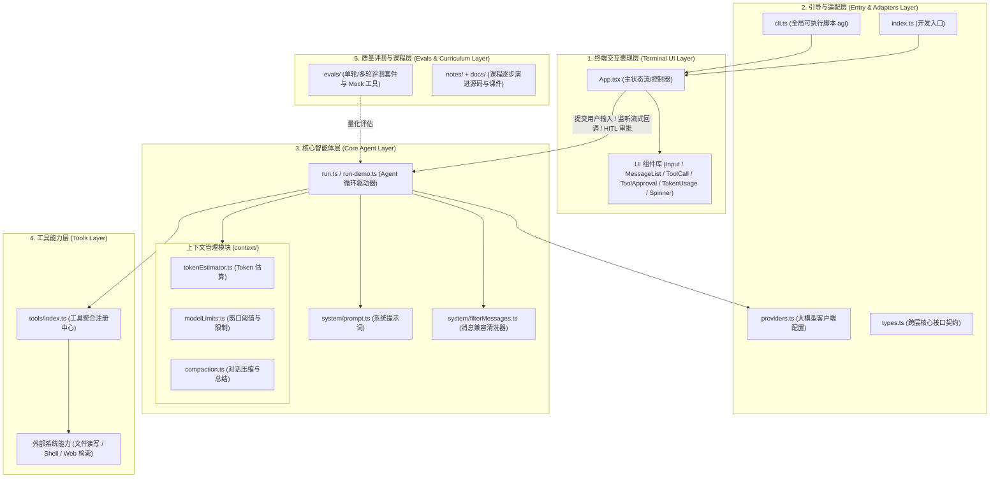

# agents-v2 仓库架构与文件功能详解

本文档全面梳理当前仓库的定位、分层架构、目录结构及所有文件的具体职责，帮助开发者快速理解系统设计与代码组织。

---

## 一、仓库定位与核心目标

本项目是 Scott Moss 大师课《从零构建 AI 智能体》（*Build an AI Agent from Scratch*，代号 `ai-agents-v2`）的完整工程实现。

### 1. 核心定位
本项目的核心目标是**抛开 LangChain、LlamaIndex 等高层框架的封装，使用 TypeScript 原生实现一个通用的终端 AI 智能体（Agent）**。通过直接基于 Vercel AI SDK 和基础大模型 API，系统性地构建智能体的各项核心机制：
- **自主循环（Agent Loop）**：维护对话历史，基于 LLM 的输出自主决定是直接回复还是发起工具调用，并在工具执行完成后将结果反馈给模型，循环迭代直至任务完成。
- **工具调用（Tool Calling）**：使用 Zod Schema 定义工具入参规范，由 LLM 生成结构化调用参数，外部运行时负责实际执行。
- **人机协同（Human-in-the-Loop, HITL）**：针对 Shell 命令、高风险文件修改等敏感工具，在执行前中断并向用户申请终端交互式授权。
- **上下文管理（Context Management）**：基于 Token 估算算法监控上下文窗口水位；当超出安全阈值（如 80%）时触发对话自动压缩与摘要。
- **评测驱动开发（Evals）**：建立单轮工具选择（查准率/查全率）与多轮交互轨迹的自动化评测套件，量化智能体的准确度与稳定性。

### 2. 核心技术栈
| 模块 / 层面 | 选用技术 | 说明 |
| :--- | :--- | :--- |
| **运行环境** | Node.js (>=20) + pnpm | 采用原生 ES 模块规范 (`"type": "module"`) |
| **开发与编译** | TypeScript + tsx | 采用严格模式，支持 `allowImportingTsExtensions` |
| **代码规范** | Biome | 快速统一的代码格式化与静态检查工具 |
| **大模型 SDK** | Vercel AI SDK (`ai`) | 配合 `@ai-sdk/deepseek`、`@ai-sdk/openai` 等适配器 |
| **终端 UI 表现** | Ink (React for CLI) | 在终端中实现类似 Web 的组件化、响应式界面交互 |
| **评测体系** | Laminar (`@lmnr-ai/lmnr`) | 自动化追踪、单轮与多轮智能体评估 |

---

## 二、分层架构设计

整个系统遵循“关注点分离”原则，清晰划分为五个层次：



### 各层职责说明：
1. **终端交互表现层 (`src/ui/`)**：基于 Ink 框架将终端渲染为富交互应用。负责流式文本输出呈现、工具执行状态指示（Pending/Success/Error）、HITL 交互式确认弹窗以及当前 Token 消耗监控。
2. **引导与适配层 (`src/index.ts`, `src/cli.ts`, `src/types.ts`, `src/agent/providers.ts`)**：负责应用的启动引导、命令行 Shebang 包装、全局 TypeScript 类型定义以及 LLM 供应商的实例初始化。
3. **核心智能体层 (`src/agent/`)**：系统的核心大脑。负责驱动大模型的生成、解析工具调用请求、执行递归循环、清洗多轮对话结构，并在上下文超出水位时调度上下文压缩模块。
4. **工具能力层 (`src/agent/tools/`)**：负责向模型暴露安全受控的系统与网络操作能力，包括文件系统操作、终端命令执行和网络检索。
5. **质量评测与演进层 (`evals/`, `notes/`, `docs/`)**：脱离 UI 独立评估智能体决策质量的测试系统，结合 9 个阶段的课程演进记录，构成项目的教学与工程闭环。

---

## 三、文件目录全景与功能详解

### 1. 根目录基础设施与配置文件

| 文件路径 | 核心职责与说明 |
| :--- | :--- |
| [package.json](file:///d:/WorkSpace/大师课/ai-courses/作者-Scott-Moss/agents-v2/package.json) | 定义项目元数据、依赖项和运行脚本。包含 `dev`（开发监听）、`start`、`build` 以及多项 `eval` 评测命令；声明了可执行命令 `agi` 指向 `dist/cli.js`。 |
| [tsconfig.json](file:///d:/WorkSpace/大师课/ai-courses/作者-Scott-Moss/agents-v2/tsconfig.json) | 开发环境下的 TypeScript 配置。配置了 `moduleResolution: "bundler"`，并开启 `allowImportingTsExtensions: true` 以支持在源码中直接引用 `.ts` / `.tsx`。 |
| [tsconfig.build.json](file:///d:/WorkSpace/大师课/ai-courses/作者-Scott-Moss/agents-v2/tsconfig.build.json) | 正式打包构建专用的配置。输出目录为 `dist/`，生成类型声明文件并支持扩展名重写。 |
| [biome.json](file:///d:/WorkSpace/大师课/ai-courses/作者-Scott-Moss/agents-v2/biome.json) | Biome 格式化与代码静态检查配置。采用 Tab 缩进与双引号规范，配置了保存时自动组织导入语句（organizeImports）。 |
| [pnpm-workspace.yaml](file:///d:/WorkSpace/大师课/ai-courses/作者-Scott-Moss/agents-v2/pnpm-workspace.yaml) | pnpm 工作区配置文件。 |
| [course.yaml](file:///d:/WorkSpace/大师课/ai-courses/作者-Scott-Moss/agents-v2/course.yaml) | 课程大纲元数据。定义了 2 天 9 个模块的课程排期、教师信息、目标受众和核心知识点。 |
| [CLAUDE.md](file:///d:/WorkSpace/大师课/ai-courses/作者-Scott-Moss/agents-v2/CLAUDE.md) | 讲师逆向课程制作工作流指南。规范了从完整版（`done` 分支）逆向拆解为 9 个课时练习分支的方法。 |
| [AGENTS.md](file:///d:/WorkSpace/大师课/ai-courses/作者-Scott-Moss/agents-v2/AGENTS.md) | 面向辅助 AI 的工程协作规范，定义了 OpenSpec 指令引导块。 |

---

### 2. 源码层：入口与公共契约 (`src/`)

| 文件路径 | 核心职责与说明 |
| :--- | :--- |
| [src/index.ts](file:///d:/WorkSpace/大师课/ai-courses/作者-Scott-Moss/agents-v2/src/index.ts) | 本地开发的主入口文件。通过 Ink 的 `render()` 函数挂载根组件 `<App />`。 |
| [src/cli.ts](file:///d:/WorkSpace/大师课/ai-courses/作者-Scott-Moss/agents-v2/src/cli.ts) | 生产环境下全局 CLI 工具的主入口。包含 `#!/usr/bin/env node` Shebang 声明，经由打包后供全局命令 `agi` 调用。 |
| [src/types.ts](file:///d:/WorkSpace/大师课/ai-courses/作者-Scott-Moss/agents-v2/src/types.ts) | 全局核心类型定义文件。声明了 `AgentCallbacks`（Token 流式吐字、工具开始/结束、人机审批、Token 用量通知）、`ToolApprovalRequest`、`ModelLimits` 以及 `TokenUsageInfo` 等接口。 |

---

### 3. 核心智能体模块 (`src/agent/`)

该目录封装了智能体所有的认知、决策与上下文控制逻辑：

| 文件路径 | 核心职责与说明 |
| :--- | :--- |
| [src/agent/run.ts](file:///d:/WorkSpace/大师课/ai-courses/作者-Scott-Moss/agents-v2/src/agent/run.ts) | 智能体主运行器接口（课程演进与重构的核心文件）。承载 `runAgent` 函数，负责串联对话历史、调用模型、拦截敏感工具触发审批、执行工具并递归推进循环。 |
| [src/agent/run-demo.ts](file:///d:/WorkSpace/大师课/ai-courses/作者-Scott-Moss/agents-v2/src/agent/run-demo.ts) | 轻量级终端调试脚本。基于 Node.js 原生 `readline` 实现了简单的 REPL 循环，用于独立验证大模型的流式生成输出。 |
| [src/agent/providers.ts](file:///d:/WorkSpace/大师课/ai-courses/作者-Scott-Moss/agents-v2/src/agent/providers.ts) | 大模型服务提供商适配文件。初始化并导出模型客户端实例（当前使用 `@ai-sdk/deepseek` 并读取 `DEEPSEEK_API_KEY`）。 |
| [src/agent/system/prompt.ts](file:///d:/WorkSpace/大师课/ai-courses/作者-Scott-Moss/agents-v2/src/agent/system/prompt.ts) | 智能体系统提示词定义文件。导出 `SYSTEM_PROMPT`，确立智能体的角色定位、回答风格以及行为准则。 |
| [src/agent/system/filterMessages.ts](file:///d:/WorkSpace/大师课/ai-courses/作者-Scott-Moss/agents-v2/src/agent/system/filterMessages.ts) | 消息兼容性过滤函数。清洗多轮对话中可能包含的异常或非文本结构的 `assistant` 消息，防止历史消息回传给大模型 API 时产生校验报错。 |
| [src/agent/tools/index.ts](file:///d:/WorkSpace/大师课/ai-courses/作者-Scott-Moss/agents-v2/src/agent/tools/index.ts) | 工具聚合出口。统一汇总并导出所有可供模型调用的工具集合（文件操作、Shell、联网查询等）。 |

#### 上下文管理子模块 (`src/agent/context/`)
负责防止多轮对话超出模型的最大上下文窗口（Context Window）：

| 文件路径 | 核心职责与说明 |
| :--- | :--- |
| [src/agent/context/tokenEstimator.ts](file:///d:/WorkSpace/大师课/ai-courses/作者-Scott-Moss/agents-v2/src/agent/context/tokenEstimator.ts) | 快速 Token 估算器。使用基于字符长度的经验系数（约 3.75 字符/Token）快速统计单条消息及整组消息的 Input/Output Token 总量。 |
| [src/agent/context/modelLimits.ts](file:///d:/WorkSpace/大师课/ai-courses/作者-Scott-Moss/agents-v2/src/agent/context/modelLimits.ts) | 各大模型上下文容量注册表。定义默认水位阈值（80%）及模型上下文上限，提供水位超限检测函数 `isOverThreshold`。 |
| [src/agent/context/compaction.ts](file:///d:/WorkSpace/大师课/ai-courses/作者-Scott-Moss/agents-v2/src/agent/context/compaction.ts) | 对话历史压缩器。当 Token 水位超标时，将较早的历史对话提取并提交给轻量模型生成摘要，以浓缩的结构替换旧消息，释放窗口空间。 |
| [src/agent/context/index.ts](file:///d:/WorkSpace/大师课/ai-courses/作者-Scott-Moss/agents-v2/src/agent/context/index.ts) | 上下文管理子模块的统一导出文件。 |

---

### 4. 终端 UI 模块 (`src/ui/`)

使用 React + Ink 实现的终端界面系统，保证在字符终端上拥有良好的可读性与即时交互反馈：

| 文件路径 | 核心职责与说明 |
| :--- | :--- |
| [src/ui/index.tsx](file:///d:/WorkSpace/大师课/ai-courses/作者-Scott-Moss/agents-v2/src/ui/index.tsx) | UI 模块总导出文件。 |
| [src/ui/App.tsx](file:///d:/WorkSpace/大师课/ai-courses/作者-Scott-Moss/agents-v2/src/ui/App.tsx) | 终端界面主控制器。管理用户消息队列、流式生成缓冲区、活动工具调用状态、Pending 中的审批任务以及 Token 用量数据；通过各种回调函数驱动 `runAgent` 执行。 |
| [src/ui/components/Input.tsx](file:///d:/WorkSpace/大师课/ai-courses/作者-Scott-Moss/agents-v2/src/ui/components/Input.tsx) | 终端文本输入组件。基于 Ink 的 `useInput` 钩子处理字符输入、退格删除、光标闪烁与回车提交。 |
| [src/ui/components/MessageList.tsx](file:///d:/WorkSpace/大师课/ai-courses/作者-Scott-Moss/agents-v2/src/ui/components/MessageList.tsx) | 对话消息列表渲染组件。区分展示用户提示词、助手最终回答以及系统错误信息。 |
| [src/ui/components/Spinner.tsx](file:///d:/WorkSpace/大师课/ai-courses/作者-Scott-Moss/agents-v2/src/ui/components/Spinner.tsx) | 动态加载动画指示器。当智能体正在思考或等待工具返回时呈现视觉加载反馈。 |
| [src/ui/components/TokenUsage.tsx](file:///d:/WorkSpace/大师课/ai-courses/作者-Scott-Moss/agents-v2/src/ui/components/TokenUsage.tsx) | 上下文窗口仪表盘。根据当前使用的百分比（绿色正常、黄色预警、红色超标）实时显示上下文水位。 |
| [src/ui/components/ToolApproval.tsx](file:///d:/WorkSpace/大师课/ai-courses/作者-Scott-Moss/agents-v2/src/ui/components/ToolApproval.tsx) | 人工审批交互弹窗（HITL）。当触发高风险工具时暂停流程，在终端提供参数预览，并允许用户通过键盘方向键选择 `Yes` 或 `No`。 |
| [src/ui/components/ToolCall.tsx](file:///d:/WorkSpace/大师课/ai-courses/作者-Scott-Moss/agents-v2/src/ui/components/ToolCall.tsx) | 工具执行状态条目。展示当前正在调用的工具名称、入参摘要、执行耗时状态以及最终返回结果。 |

---

### 5. 质量评测体系 (`evals/`)

基于 Laminar 与真实场景数据构建的评测模块，保证智能体在迭代时不会退化：

| 文件路径 | 核心职责与说明 |
| :--- | :--- |
| [evals/types.ts](file:///d:/WorkSpace/大师课/ai-courses/作者-Scott-Moss/agents-v2/evals/types.ts) | 评测数据结构定义文件。定义单轮测试目标 `EvalTarget`、多轮测试目标 `MultiTurnTarget` 及对应的产出结果类型。 |
| [evals/evaluators.ts](file:///d:/WorkSpace/大师课/ai-courses/作者-Scott-Moss/agents-v2/evals/evaluators.ts) | 评估算法集。实现工具选型精准度打分（基于准确率 Precision、召回率 Recall 的 F1 分数计算）。 |
| [evals/executors.ts](file:///d:/WorkSpace/大师课/ai-courses/作者-Scott-Moss/agents-v2/evals/executors.ts) | 评测执行驱动器。将评测数据集注入智能体或模型并收集执行结果。 |
| [evals/utils.ts](file:///d:/WorkSpace/大师课/ai-courses/作者-Scott-Moss/agents-v2/evals/utils.ts) | 评测辅助工具函数集合。 |
| [evals/mocks/tools.ts](file:///d:/WorkSpace/大师课/ai-courses/作者-Scott-Moss/agents-v2/evals/mocks/tools.ts) | 评测专用的 Mock 工具集合。避免在运行批量测试时产生真实的副作用或网络调用开销。 |
| `evals/data/*.json` | 预设评测数据集：<br>- `file-tools.json`：文件操作场景评测用例<br>- `shell-tools.json`：Shell 命令执行评测用例<br>- `agent-multiturn.json`：多轮复合任务轨迹评测用例 |

---

### 6. 课程设计与讲义体系 (`notes/` 与 `docs/`)

| 文件/目录路径 | 核心职责与说明 |
| :--- | :--- |
| `notes/01-Intro-to-Agents.md` ~ `09-HITL.md` | 英文版核心讲义及分步练习代码。循序渐进涵盖：<br>01. 智能体基础概念<br>02. 工具调用机制<br>03. 单轮评测设计<br>04. 核心 Agent Loop 构建<br>05. 多轮评测设计<br>06. 文件系统工具集成<br>07. 联网搜索与上下文管理<br>08. Shell 工具封装与安全防护<br>09. 人机协同审批机制 (HITL) |
| [docs/01-Intro-to-Agents.md](file:///d:/WorkSpace/大师课/ai-courses/作者-Scott-Moss/agents-v2/docs/01-Intro-to-Agents.md) | 智能体入门中文解析教程，详细对比了单纯 LLM 与智能体的能力边界。 |
| [docs/终端运行文件坑点.md](file:///d:/WorkSpace/大师课/ai-courses/作者-Scott-Moss/agents-v2/docs/终端运行文件坑点.md) | 针对终端运行路径（`process.cwd()`）与 `.env` 环境变量查找机制的实操避坑指南。 |
| [openspec/project.md](file:///d:/WorkSpace/大师课/ai-courses/作者-Scott-Moss/agents-v2/openspec/project.md) | 项目规格与技术架构概述。 |

---

## 四、核心工作流程详解

### 1. 智能体执行闭环（Agent Loop）
当用户在输入框键入需求并回车时，系统的执行流如下：

```
用户输入 (Input)
   │
   ▼
添加到本地展示状态 (setMessages)
   │
   ▼
发起运行 runAgent(userInput, conversationHistory, callbacks)
   │
   ├─► 1. 统计当前消息 Token 水位 (tokenEstimator)
   │      └─ 超出阈值？──► 触发对话压缩 (compactConversation)
   │
   ├─► 2. 将系统提示词与历史清洗整合 (filterCompatibleMessages)
   │
   ├─► 3. 发起模型调用 streamText({ model, messages, tools })
   │      │
   │      ├─► 生成纯文本 Token ──► 触发 callbacks.onToken ──► 终端流式打字效果
   │      │
   │      └─► 生成工具调用 (tool-calls)
   │            │
   │            ├─► 该工具是否敏感？
   │            │     └─ 是 ──► 触发 callbacks.onToolApproval ──► 终端显示 [Yes/No] 审批弹窗
   │            │           └─ 用户拒绝？──► 返回 "Tool call denied by user"
   │            │
   │            ├─► 触发 callbacks.onToolCallStart ──► 终端显示运行状态条
   │            ├─► 执行工具实际逻辑
   │            ├─► 触发 callbacks.onToolCallEnd ──► 状态变为 Complete
   │            │
   │            └─► 将工具结果组装为 tool-result 消息追加到历史
   │                  │
   │                  └─► 递归进入步骤 2，让模型继续处理结果并决定下一步
   │
   └─► 4. 模型生成最终回答 (finishReason !== 'tool-calls') ──► 触发 callbacks.onComplete ──► 结束本次交互
```

### 2. 人机协同（Human-in-the-Loop）机制
敏感操作（如执行任意 Shell 命令、删除本地文件）若完全交由模型自主运行，极易引发误删或系统损坏。
- 系统通过 `AgentCallbacks.onToolApproval` 建立了一个基于 `Promise` 的挂起机制。
- 执行器发现工具需要审批时，不会直接执行，而是调用该回调函数，将控制权交给 UI。
- [ToolApproval.tsx](file:///d:/WorkSpace/大师课/ai-courses/作者-Scott-Moss/agents-v2/src/ui/components/ToolApproval.tsx) 截获按键事件并呈现参数摘要（如将要执行的 Shell 指令）。
- 用户选定并回车后，UI 调用 `resolve(true/false)`，底层的 Promise 解除挂起，执行器据此继续执行或终止该调用。

---

## 五、开发与日常操作指南

### 1. 环境变量配置
在项目根目录下确保存在 `.env` 文件，并配置相应大模型的 API Key：
```bash
DEEPSEEK_API_KEY=sk-xxxxxxxxxxxxxxxxxxxxxxxxxxxxxxxx
# 或使用 OpenAI
OPENAI_API_KEY=sk-proj-xxxxxxxxxxxxxxxxxxxxxxxxxxxx
```

### 2. 启动开发调试
```bash
# 安装依赖
pnpm install

# 启动终端交互应用（支持热重载，自动加载根目录 .env）
pnpm dev

# 或者单独运行简单控制台 REPL 模式
pnpm exec tsx src/agent/run-demo.ts
```

### 3. 运行评测套件
```bash
# 运行文件工具评测
pnpm run eval:file-tools

# 运行终端 Shell 工具评测
pnpm run eval:shell-tools

# 运行多轮对话轨迹评测
pnpm run eval:agent
```

### 4. 构建与全局安装
```bash
# 编译 TypeScript 至 dist/
pnpm run build

# 全局链接本地包（开发调试 CLI）
npm install -g .

# 在任意目录下启动智能体
agi
```
